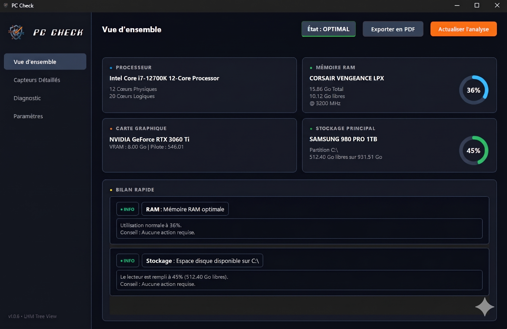
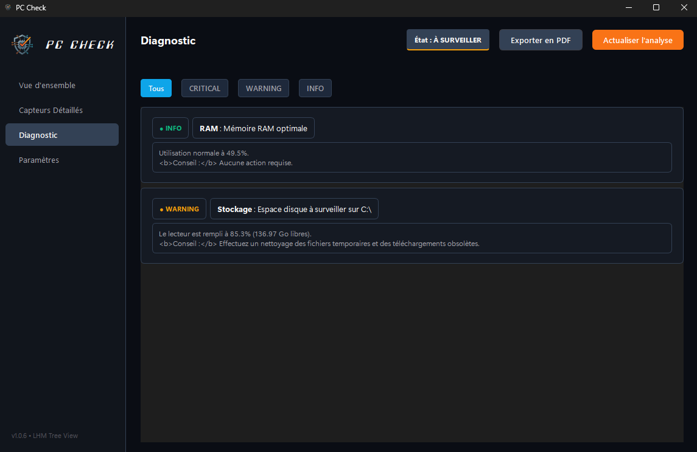
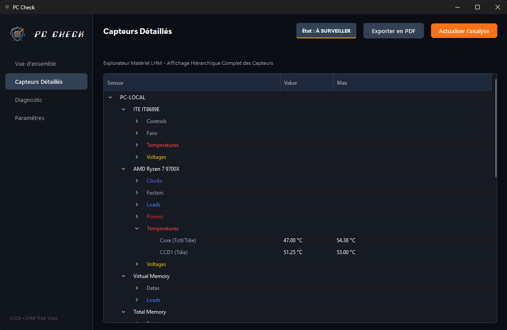

# PC-Check - Diagnostic Matériel Local

PC-Check est un utilitaire de diagnostic matériel conçu pour les environnements Windows. Il permet de lire en temps réel les sondes de votre machine (températures, tensions, charges) de manière 100% locale, sans aucun service en arrière-plan ni envoi de données vers le cloud.

Ce projet s'adresse aussi bien aux particuliers souhaitant surveiller leur système qu'aux techniciens informatiques ayant besoin d'éditer des rapports d'intervention fiables.

https://www.pc-check.fr

## Aperçu de l'application

| Vue d'ensemble | Diagnostic intelligent |
| :---: | :---: |
|  |  |
| *Tableau de bord principal et état du système* | *Centre de diagnostic et alertes ciblées* |

| Capteurs Détaillés (LHM) |
| :---: |
|  |
| *Explorateur hiérarchique des sondes et composants* |

## Fonctionnalités

* **Surveillance matérielle avancée :** Lecture des données du processeur (CPU), de la carte graphique (GPU), de la mémoire vive (RAM) et des disques de stockage.
* **Intégration bas niveau :** Exploitation de la bibliothèque LibreHardwareMonitor (LHM) pour communiquer directement avec les contrôleurs Super I/O (ITE, Nuvoton, etc.) de la carte mère.
* **Génération de rapports :** Création instantanée d'un diagnostic au format PDF, listant les spécifications du système et les avertissements (surchauffe, disque saturé, etc.).
* **Exécution autonome :** Disponible via un installateur propre ou en version portable, sans nécessiter l'installation de Python sur la machine cible.

## Prérequis

* Système d'exploitation : Windows 10 ou Windows 11 (64-bits).
* Droits d'exécution : L'application nécessite les privilèges Administrateur au lancement pour autoriser le pilote matériel (Ring0) à interroger les sondes physiques.

## Installation et Utilisation

1. Rendez-vous dans l'onglet "Releases" de ce dépôt.
2. Téléchargez le fichier d'installation `PC-Check-Setup-v1.0.6.exe`.
3. Exécutez le fichier pour installer l'application dans votre répertoire Program Files.
4. Lancez PC-Check depuis le menu Démarrer ou le raccourci bureau. Une invite de contrôle de compte d'utilisateur (UAC) vous demandera l'autorisation administrateur.

## Architecture et Stack Technique

Ce logiciel a été développé pour offrir une empreinte mémoire minimale tout en garantissant une interface fluide.

* Langage principal : Python 3.x
* Interface Graphique (GUI) : PySide6 (framework Qt)
* Moteur matériel : LibreHardwareMonitorLib.dll (C# / .NET) interfacé avec Python via pythonnet.
* Déploiement : Code compilé via PyInstaller et empaqueté dans un installeur Windows avec Inno Setup.

## Mentions Légales et Auteur

Développé par Redouane MHEND.
Ce logiciel est fourni en l'état. L'utilisation se fait sous l'entière responsabilité de l'utilisateur final.
